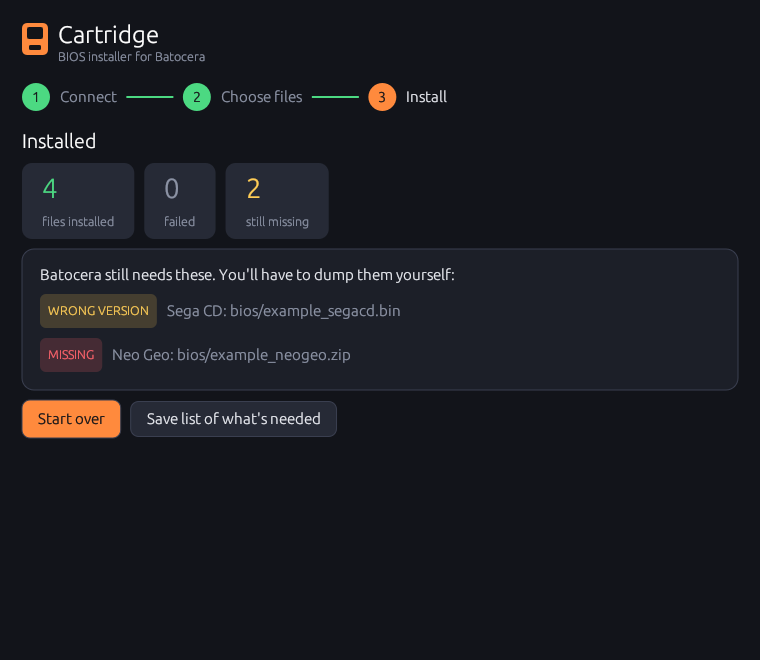

<p align="center"></p>

A small desktop app that installs the BIOS files **you already own** onto a
[Batocera](https://batocera.org) device over your home network. It runs on **Windows and Linux**.

## BIOS Files downloadable [Here](https://abdess.github.io/retrobios/get/batocera/)

<p align="center"></p>

## How it works

### 1. Connect
Enter your Batocera's IP address (Batocera: *Main menu > Network Settings*). The defaults are user `root` and
password `linux`.

<p align="center"></p>

Cartridge runs Batocera's own `batocera-systems` command over SSH. It lists exactly which BIOS files your
installed emulators are missing (`MISSING`) or have in the wrong version (`UNTESTED`), with the expected MD5
checksums.

### 2. Choose your files
Pick (or drag in) a folder with your BIOS dumps. Subfolders are searched. Cartridge calculates MD5s and matches
your files to what Batocera needs. A file with the right MD5 is used even if it is named differently, and it is
uploaded under the name Batocera expects. You can also save a list of everything still needed, so you know what
to dump.

### 3. Install
Matched files are uploaded by SFTP into `/userdata/bios/`, including subfolders like `bios/np2kai/`.
Cartridge then re-checks with Batocera and tells you what is still missing.

<p align="center">
  
  
</p>

*The screenshots use demo data with placeholder file names.*

## Where Batocera keeps BIOS files

All BIOS files go in `/userdata/bios/`. You can also reach that folder through the network share at
`\\BATOCERA\share\bios` (Windows) or `smb://batocera/share/bios` (Linux). The current list for your version
is in EmulationStation under *System Settings > Missing BIOS*, or by running `batocera-systems` over SSH.

## Download and install

Get the latest version from the [**Releases**](../../releases/latest) page and pick the file for your computer:

| Your computer | Windows | Linux (with app-menu installer) | Linux (raw program) |
|---|---|---|---|
| **Intel / AMD** (most PCs, called x86_64 or "x64") | `cartridge-windows-x86_64.exe` | `cartridge-linux-x86_64.zip` | `cartridge-linux-x86_64` |
| **ARM** (aarch64 / arm64, e.g. Snapdragon laptops, Raspberry Pi) | `cartridge-windows-aarch64.exe` | `cartridge-linux-aarch64.zip` | `cartridge-linux-aarch64` |

Not sure? On Windows check *Settings > System > About > System type*. On Linux run `uname -m`
(`x86_64` = Intel/AMD, `aarch64` = ARM).

**Windows:** just download the `.exe` and double-click it. No install or unzip needed. (Windows may show a
SmartScreen warning because the app isn't code-signed: click *More info > Run anyway*.)

**Linux:** if you want it in your app menu, unzip the zip and run the installer:

```
./install-linux.sh
```

That puts Cartridge in your app menu with its icon. Search for "Cartridge" (log out and back in once if it
doesn't appear right away). To remove it: `./install-linux.sh --uninstall`. You can also just run `./cartridge`
without installing. (If your system says the script isn't executable, run `sh install-linux.sh` instead.)

**Linux, raw program:** download `cartridge-linux-<your type>`, then run `chmod +x cartridge-linux-x86_64`
(or `-aarch64`) and start it with `./cartridge-linux-x86_64`. Downloads don't keep the executable permission, so
the `chmod` step is needed.

Releases are built by GitHub Actions. Pushing a tag like `v0.2.1` builds and publishes a new one.

## Build it yourself

1. Install Rust from <https://rustup.rs>.
2. Linux only: `sudo apt install libgtk-3-dev` (or your distro's equivalent), plus a C compiler, `perl` and `make`.
3. Run `cargo run --release`.

## Notes

- SSH must be enabled on Batocera (it is by default).
- Your password is only sent to the Batocera device you enter.
- Files with the wrong checksum are never installed.
- Preview the interface without a device: set `CARTRIDGE_DEMO=pick` (or `connect`, `install`, `done`).

## Credits

Created by AJ-64x with code written by [Claude](https://claude.ai) (Anthropic).
