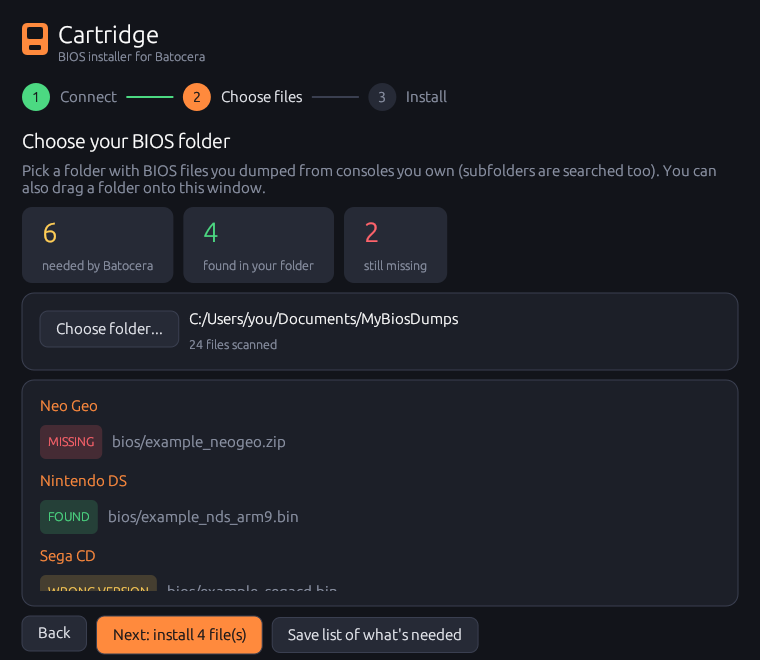
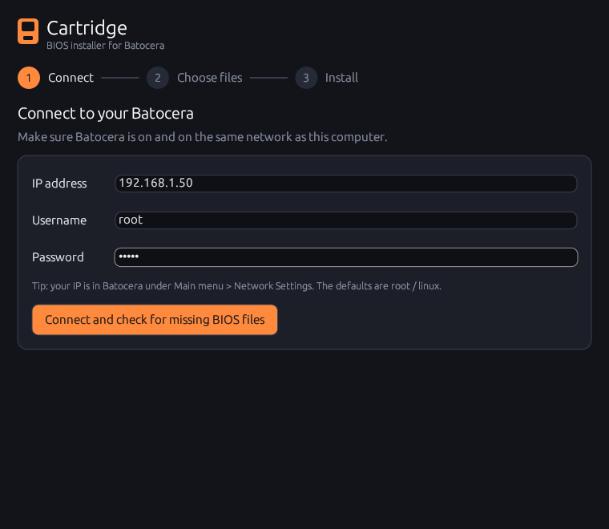
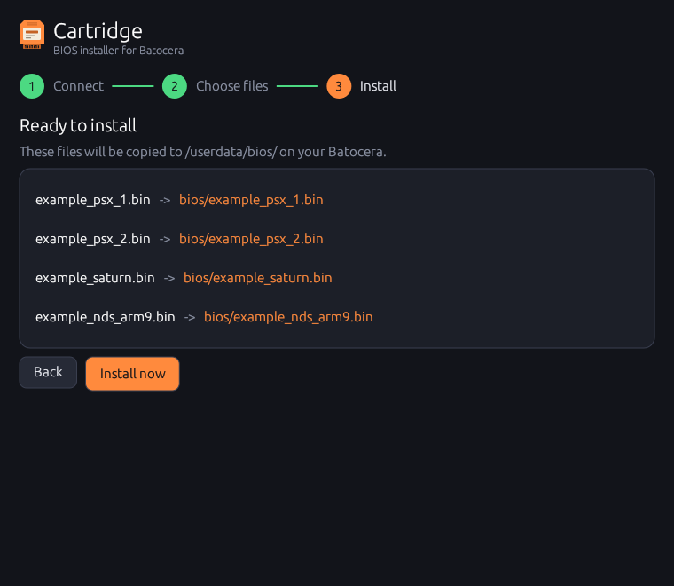

# Cartridge

A small desktop app that installs the BIOS files **you already own** onto a
[Batocera](https://batocera.org) device over your home network. It runs on **Windows and Linux**.

## BIOS Files downloadable [Here](https://https://abdess.github.io/retrobios/get/batocera/)

## How it works

### 1. Connect
Enter your Batocera's IP address (Batocera: *Main menu > Network Settings*). The defaults are user `root` and
password `linux`.

Cartridge runs Batocera's own `batocera-systems` command over SSH. It lists exactly which BIOS files your
installed emulators are missing (`MISSING`) or have in the wrong version (`UNTESTED`), with the expected MD5
checksums.

### 2. Choose your files
Pick (or drag in) a folder with your BIOS dumps. Subfolders are searched. Cartridge calculates MD5s and matches
your files to what Batocera needs. A file with the right MD5 is used even if it is named differently, and it is
uploaded under the name Batocera expects. You can also save a list of everything still needed, so you know what
to dump.

### 3. Install
Matched files are uploaded by SFTP into `/userdata/bios/`, including subfolders like `bios/np2kai/`.
Cartridge then re-checks with Batocera and tells you what is still missing.

  
  

*The screenshots use demo data with placeholder file names.*

## Where Batocera keeps BIOS files

All BIOS files go in `/userdata/bios/`. You can also reach that folder through the network share at
`\\BATOCERA\share\bios` (Windows) or `smb://batocera/share/bios` (Linux). The current list for your version
is in EmulationStation under *System Settings > Missing BIOS*, or by running `batocera-systems` over SSH.

## Download

Builds for Windows and Linux are made by GitHub Actions: open the **Actions** tab, pick the latest successful
run and download the file for your system. Tagging a version like `v0.1.0` also publishes a release.

## Build it yourself

1. Install Rust from <https://rustup.rs>.
2. Linux only: `sudo apt install libgtk-3-dev` (or your distro's equivalent), plus a C compiler, `perl` and `make`.
3. Run `cargo run --release`.

## Notes

- SSH must be enabled on Batocera (it is by default).
- Your password is only sent to the Batocera device you enter.
- Files with the wrong checksum are never installed.
- Preview the interface without a device: set `CARTRIDGE_DEMO=pick` (or `connect`, `install`, `done`).

## Credits

Created by AJ-64x with code written by [Claude](https://claude.ai) (Anthropic).
